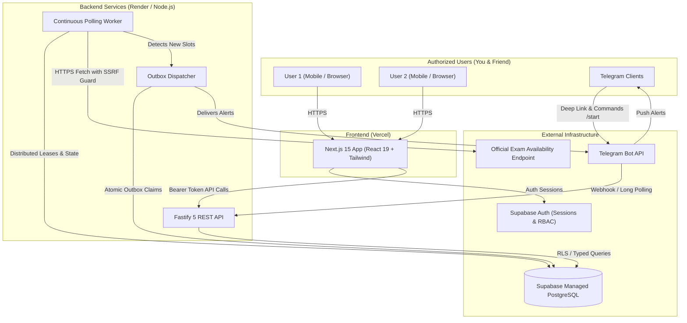
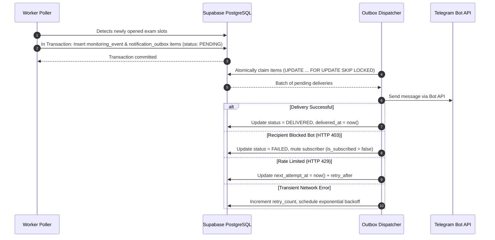

# System Architecture — Exam Monitor

Exam Monitor is a high-availability, production-ready driving exam availability monitoring application designed to serve authorized users across various devices with real-time Telegram notifications.

---

## 🏛️ Architecture Overview

The system is organized as a clean TypeScript monorepo using **pnpm workspaces**, completely decoupling user-facing presentation, HTTP API management, background polling scheduling, and notification delivery.



---

## 📦 Monorepo Workspace Boundaries

The codebase enforces strict separation of concerns across packages and applications:

```text
exam-monitor/
├── apps/
│   ├── web/               # Next.js 15 frontend dashboard (App Router, Tailwind CSS, Supabase SSR)
│   ├── api/               # Fastify 5 REST API (Auth, target management, webhook receiver, OpenAPI)
│   └── worker/            # Continuous background worker (Scheduler, DB leases, slot detector)
├── packages/
│   ├── config/            # Shared Zod environment schemas & cross-package configuration
│   ├── database/          # Drizzle ORM schema, versioned SQL migrations, connection pooler
│   ├── exam-provider/     # SSRF hardening, URL validation, response parser, simulation & benchmarks
│   ├── notifications/     # Telegram Bot API client, command router, outbox delivery queue
│   └── shared/            # Common domain types, cryptographic token utilities, secure redacting logger
├── supabase/
│   ├── config.toml        # Supabase CLI project configuration
│   ├── migrations/        # Authoritative versioned SQL migrations & RLS policies
│   └── seed.sql           # Development seed fixtures
└── docs/                  # In-depth architectural, deployment, and operational guides
```

---

## 🔒 Concurrency & Single-Worker Distributed Leases

To guarantee that multiple instances or server restarts never cause competing duplicate requests to the government endpoint:

1. **PostgreSQL Atomic Leases**: The worker utilizes the `worker_leases` table.
2. **Atomic Upsert**:
   ```sql
   INSERT INTO worker_leases (target_id, worker_id, acquired_at, expires_at, last_heartbeat)
   VALUES ($1, $2, now(), now() + interval '30 seconds', now())
   ON CONFLICT (target_id) DO UPDATE
   SET worker_id = $2,
       expires_at = now() + interval '30 seconds',
       last_heartbeat = now()
   WHERE worker_leases.worker_id = $2 OR worker_leases.expires_at < now()
   RETURNING worker_id;
   ```
3. **Lease Expiry**: If a worker process terminates abnormally, its lease expires after 30 seconds, enabling another active worker to take over without manual intervention.

---

## 📬 Transactional Notification Outbox

To prevent lost alerts during worker restarts and eliminate duplicate notifications:


